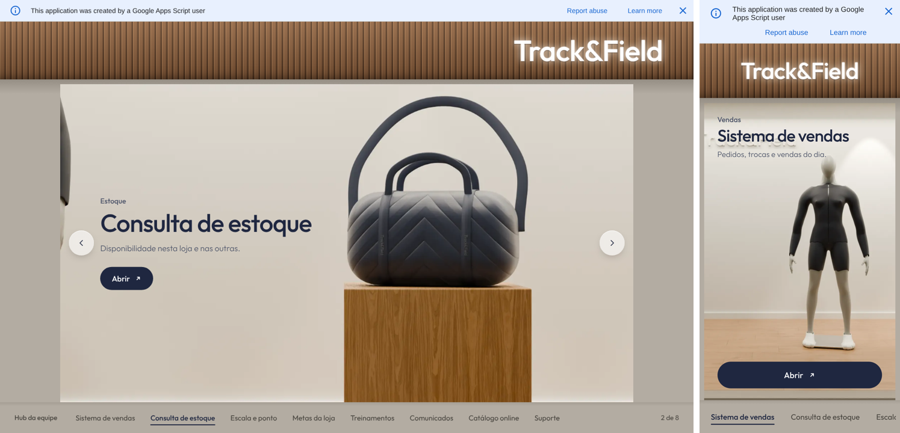
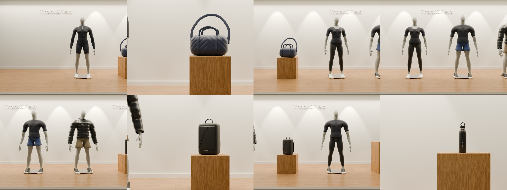

# Hub da equipe Track&Field

Página de links da equipe com o tema da vitrine da loja. A câmera passa pela vitrine e cada manequim ou cubo leva a um site. A lupa consulta e soma produtos com leitor de código de barras ao vivo. O site fica no GitHub Pages, sem login; os links vêm de uma Planilha Google, lida por um Apps Script que também consulta o site da TF.

| | |
|---|---|
| Hub (endereço da equipe) | <https://lucasfranco-dev.github.io/hub-trackfield/> |
| Servidor de dados (Apps Script) | <https://script.google.com/macros/s/AKfycbxawbOdgqsfsxDmw7Tn0IR1l_76XcU93D5uxSl2q78mPSBlMnPn5A2DqqE8l1pIAR0bbQ/exec> (endereço antigo do Hub) |
| Planilha de links | [Hub Track&Field: links](https://docs.google.com/spreadsheets/d/1eSkaq6dsmBnoYOXWYdMJFE7LAEQMngrRszZE_ed4OUE/edit) |
| Projeto no Apps Script | [abrir no editor](https://script.google.com/d/1g-Re2_3aVLnRRAj_56KY8RO1RIAdNUp-9NhAM2XxMt5NHkWEf-Kkn_2c/edit) |
| Histórico de mudanças | [CHANGELOG.md](CHANGELOG.md) |



## Estrutura

| Caminho | O que é |
|---|---|
| `web/index.html` | O site do Hub: fachada, vitrine e a lupa. |
| `web/estilo.css`, `web/vitrine.js` | Visual e navegação da vitrine (renders, travelling, links da planilha). |
| `web/lupa.css`, `web/lupa.js` | A lupa: consulta e soma de produtos com leitor de código de barras ao vivo. |
| `web/hub.js` | Endereço do servidor de dados (Apps Script) e a função que fala com ele. |
| `scripts/montar-site.sh` | Junta `web/` e `midia/` em `_site/`, o que vai para o GitHub Pages. |
| `.github/workflows/publicar-site.yml` | Publica o site no GitHub Pages a cada mudança em `web/` ou `midia/` na `main`. |
| `src/Code.gs` | Servidor de dados: responde em JSON com os links da planilha (`?acao=links`) e a consulta de produtos no site da TF (`?acao=produto&q=...`). |
| `src/Index.html` | Página do endereço antigo do Hub (Apps Script): avisa que o Hub mudou e tem o botão para o endereço novo. |
| `src/appsscript.json` | Manifesto do Apps Script: fuso horário e acesso do app da Web (qualquer pessoa, sem login). |
| `package.json` | Dependência do clasp e, em `config.deploymentId`, o ID da implantação do app da Web. |
| `scripts/publicar.sh` | Envia `src/` para o Apps Script e atualiza a implantação. |
| `.github/workflows/publicar.yml` | Roda o `publicar.sh` a cada mudança em `src/` na branch `main`. |
| `.clasp.json` | Liga a pasta `src/` ao projeto do Apps Script. |
| `3d/vitrine.py` | Monta a vitrine no Blender por script e renderiza uma parada (veja [Vitrine 3D](#vitrine-3d)). |
| `3d/produtos.py` | Veste os manequins com as roupas de cada parada e modela as malas e a garrafa. |
| `3d/gerar_manequins.py` | Gera os manequins feminino e masculino a partir do MakeHuman (MPFB 2, CC0). |
| `3d/modelos/` | Manequins prontos em `.glb`, com as regiões do corpo marcadas em cada vértice. |
| `3d/renderizar_todas.sh` | Renderiza as 8 paradas e gera as imagens da página. |
| `3d/renderizar_maxima.sh` | Renderiza tudo em qualidade máxima, para um computador com placa de vídeo. |
| `3d/verificar.sh` | Confere se o computador está pronto para renderizar (Python, Pillow, ffmpeg, texturas, GPU). |
| `3d/ambiente.sh` | Configuração comum dos scripts: acha o Python do venv no Linux, Mac e Windows. |
| `3d/exportar_midia.py` | Converte os renders das paradas nas imagens WebP da página (`midia/paradas/`). |
| `3d/renderizar_transicoes.sh` | Renderiza o travelling de câmera entre paradas vizinhas e gera os vídeos (`midia/transicoes/`). |
| `3d/baixar_texturas.sh` | Baixa as texturas de madeira (CC0, Poly Haven) para `3d/texturas/`, que fica fora do Git. |
| `3d/fontes/` | Fonte Outfit do letreiro (licença SIL OFL em `OFL.txt`). |
| `3d/renders/` | Renders originais das paradas (PNG 2400x1800, feitos com `3d/renderizar_maxima.sh`). |
| `midia/` | Imagens e vídeos da vitrine, publicados junto com o site (veja [Mídias da página](#mídias-da-página)). |
| `docs/` | Conceito visual (`conceito/storyboard.html`) e prévias da página. |

## Editar os links

Os links ficam na planilha, não no código. A mudança aparece no Hub em até 1 minuto (o script guarda a lista em cache por esse tempo).

| Coluna | Uso |
|---|---|
| Ordem | Posição na vitrine, da esquerda para a direita. |
| Ativo | Desmarque para esconder o link sem apagar a linha. |
| Nome | Texto do letreiro e da barra de links. |
| Categoria | Linha pequena acima do nome. |
| Descrição | Uma frase sobre o destino. |
| URL | Endereço completo, começando com `https://`. Outros formatos são ignorados. |
| Produto | Produto da vitrine 3D que representa o link (lista na própria coluna). Se ficar vazio ou não for um dos 8, o link usa a parada da mesma posição. |

## Lupa: consulta e soma de produtos

A lupa no canto da fachada (ou a tecla `/`) abre um painel com dois modos, que se alternam pelas abas no topo. O modo escolhido fica guardado no aparelho.

**Consulta.** Busca por:

| Busca | Exemplo | Resultado |
|---|---|---|
| Código de barras (EAN) | `7909563108891` | O produto e o tamanho daquele código. |
| Código TF do modelo | `TF041024` | Todas as cores do modelo. |
| Código TF com a cor | `TF041024-0003` | Só aquela cor. |
| Parte do nome | `jaqueta winter` | Até 12 produtos parecidos. |

Cada resultado mostra a foto, o nome, o código TF, o número e o nome da cor (ex.: `Cor 0004 Azul Noturno`), o preço e, se houver promoção, o preço cheio riscado e a porcentagem de desconto. "Ver no site" abre a página do produto.

**Soma.** Cada código bipado (ou digitado) entra numa lista e o total soma sozinho:

- o mesmo EAN de novo aumenta a quantidade; os botões − e + também;
- no − com 1 unidade (lixeira) ou em "Remover", o item sai, com **Desfazer**;
- busca por TF ou nome mostra os produtos com **Adicionar à soma** (sem tamanho, porque o tamanho vem do EAN);
- o rodapé mostra quantos itens, o total e, se houver promoção, quanto seria sem desconto e a economia;
- **Limpar soma** pede um segundo toque para confirmar;
- a soma fica guardada no aparelho (recarregar a página não perde) e a aba Soma mostra quantos itens tem.

**Leitor ao vivo.** "Ler código de barras" liga a câmera traseira e lê uns 8 quadros por segundo, com bipe e vibração a cada leitura. O mesmo código só conta de novo depois de sair da câmera por 1,2 s, para a etiqueta parada na frente não somar várias vezes. Usa o `BarcodeDetector` do navegador ou, onde ele não existe (iPhone), a mesma biblioteca do sistema de contagem de estoque (`barcode-detector@3.2.3`, baseada no ZXing). A câmera desliga ao fechar a lupa ou trocar de aba. No computador, digite o código ou use um leitor de código de barras USB/Bluetooth, que funciona como teclado e termina com Enter.

**De onde vêm os dados.** O site chama a API do Apps Script (`?acao=produto&q=...`, função `buscarProduto` em `src/Code.gs`), que consulta a busca do site `tf.com.br` (para EAN confere o código exato e, se precisar, usa o catálogo), resume o resultado e guarda cada consulta em cache por 10 minutos. O navegador não chama o site da TF direto porque ele bloqueia (CORS). Preço e disponibilidade são os da loja online.

**Por que o site saiu do Apps Script.** O Apps Script abre a página dentro de um iframe do Google sem permissão de câmera, então só dava para ler o código de uma foto. No GitHub Pages o leitor funciona ao vivo; o Apps Script ficou como servidor de dados.

**Autorização.** A consulta usa a permissão do Google "conectar a um serviço externo" (`UrlFetchApp`), já autorizada. Se um dia ela for revogada, a conta dona do script autoriza de novo: abra o [projeto no Apps Script](https://script.google.com/d/1g-Re2_3aVLnRRAj_56KY8RO1RIAdNUp-9NhAM2XxMt5NHkWEf-Kkn_2c/edit), escolha a função `autorizarConsulta`, clique em **Executar** e aceite.

## Desenvolvimento

1. `npm install`
2. Para ver o site sem publicar: `sh scripts/montar-site.sh && python3 -m http.server -d _site 8080` e abra <http://localhost:8080>. Ele usa os links e a consulta de verdade, pela API do Apps Script. A câmera precisa de `localhost` ou HTTPS.
3. Faça a mudança, atualize a documentação (veja abaixo) e faça o commit na `main`.

Navegação: setas na tela, teclado (← →, Home, End, 1 a 9, Enter abre o link atual, `/` abre a lupa), roda do mouse, arrastar com o mouse ou deslizar o dedo, e a barra com todos os links. Entre produtos vizinhos na vitrine a câmera faz o travelling em vídeo; em saltos maiores, ou com "reduzir movimento" ligado no aparelho, a imagem troca com um fade.

Os links da planilha ficam guardados no aparelho: a vitrine abre na hora com a última lista e se atualiza quando a resposta do servidor chega.

## Publicação

O código publicado é sempre o que está na `main`.

**Automática.** São dois workflows, cada um com sua parte:

| Workflow | Quando roda | O que faz |
|---|---|---|
| **Publicar site no GitHub Pages** | push na `main` que muda `web/`, `midia/` ou `scripts/montar-site.sh` | Monta `_site/` e publica o site em <https://lucasfranco-dev.github.io/hub-trackfield/>. |
| **Publicar no Apps Script** | push na `main` que muda `src/` | Envia o servidor de dados com o clasp e atualiza a implantação (a URL da API não muda). |

Os dois também rodam à mão na aba **Actions**.

**Manual**, de um computador com as credenciais do clasp:

```sh
npm run publicar
```

O script envia `src/` com `clasp push` e atualiza a implantação cujo ID está em `package.json` (`config.deploymentId`). Nunca crie uma implantação nova: a URL da equipe mudaria.

### Configuração inicial (uma vez)

1. Ative a **API do Google Apps Script** em <https://script.google.com/home/usersettings>.
2. **Autorize o script:** abra a URL do Hub logado com a conta dona do script e aceite as permissões. Sem isso, quem não tem login vê "acesso negado".
3. **GitHub Pages:** em **Settings → Pages → Build and deployment → Source**, escolha **GitHub Actions**.
4. **Credenciais para o GitHub Actions:** no seu computador, rode `npx @google/clasp login` e autorize com a conta dona do script. Isso cria o arquivo `~/.clasprc.json`. No GitHub, em **Settings → Secrets and variables → Actions → New repository secret**, crie `CLASPRC_JSON` com o conteúdo inteiro desse arquivo.

Sem o segredo, o workflow termina com um aviso e não publica. O `~/.clasprc.json` dá acesso aos seus scripts do Google: ele nunca entra no repositório (está no `.gitignore`) e não deve ser colado em conversas ou issues.

O script do Apps Script é independente, não vinculado à planilha. Ele abre a planilha pelo ID que está em `src/Code.gs` (`ID_PLANILHA`).

## Vitrine 3D

A loja é montada inteira por código em `3d/vitrine.py`, com o Blender como módulo Python (`bpy`) e render no Cycles:

- fachada com ripado de madeira e letreiro iluminado na fonte Outfit;
- vidro contínuo com reflexos das luminárias do corredor;
- piso de madeira, parede branca e fachos de luz dos spots (o logo em relevo na parede existe, mas está desligado em `LOGO_EM_RELEVO`: ficava atrás do nome do link na página);
- 8 paradas na ordem da planilha: manequins vestidos com os produtos e cubos de madeira com malas e garrafa.



**Manequins.** `gerar_manequins.py` usa o corpo base do MakeHuman pelo add-on MPFB 2 (licença CC0, sem login): proporções de manequim de loja, braços relaxados e cabeça lisa em forma de ovo, sem rosto. Cada vértice guarda a região do corpo (`_REGIAO`: tronco, braço, coxa...) e a posição ao longo do osso (`_T`). Os `.glb` já gerados estão em `3d/modelos/`; para gerar de novo é preciso o zip do MPFB (<https://extensions.blender.org/add-ons/mpfb/>):

```sh
.venv-blender/bin/python 3d/gerar_manequins.py --mpfb add-on-mpfb-v2.0.18.zip
```

**Produtos.** Em `produtos.py`, cada roupa é uma casca da superfície do manequim: escolhe as regiões que cobre, corta barra, punho e gola e se afasta do corpo alguns milímetros (ou mais, com gomos, na jaqueta acolchoada). Cores e detalhes seguem as fotos do site: os "pretos" da marca são um azul-marinho muito escuro, o shorts Laser é azul, o casaco tem zíper e gola alta, a camiseta ThermoDry tem o recorte em gota nas costas, a Sports tem logo e faixa refletivos. Malas e garrafa são modeladas por forma (matelassê em chevron da duffel, alças de mochila da Mala Trip, anel metálico e tampa com alça da garrafa).

| Parada | Produto | Expositor |
|---|---|---|
| 1 | Casaco PowerCool, com bermuda de ciclista | Manequim feminino |
| 2 | Mala Duffel Matelassê | Cubo |
| 3 | Camiseta ThermoDry Gota, com legging | Manequim feminino |
| 4 | Shorts Laser, com camiseta Sports | Manequim masculino |
| 5 | Jaqueta Winter, com bermuda caqui | Manequim masculino |
| 6 | Mala Trip | Cubo |
| 7 | Camiseta Sports, com legging | Manequim masculino |
| 8 | Garrafa Urban 950 ml | Cubo |

Para trocar o produto de uma parada, mude `PARADAS` em `vitrine.py` e, se for um produto novo, crie a função dele em `produtos.py`.

A câmera fica do lado de fora, sem inclinação (as verticais ficam retas), com o produto em 65% da largura. Nos manequins ela mostra o corpo inteiro; nos cubos usa uma lente mais longa, na altura do produto. O render sai em 4:3; a página recorta para a tela (no computador a vitrine é no máximo 1,8 vez mais larga que alta, para não cortar cabeças; no celular o recorte é vertical, centrado no produto). Em telas mais largas que isso, as laterais continuam a cena com o próprio render, espelhado e desfocado como a profundidade de campo de uma lente, e as bordas da vitrine se dissolvem nele; o rodapé da parede e o piso ficam na mesma linha. O nome do link fica num adesivo jateado (placa fosca no vidro), legível mesmo com um manequim vizinho atrás.

**Transições.** Para cada par de paradas vizinhas, `vitrine.py --transicao` anima a câmera de uma até a outra (aceleração e frenagem suaves; a lente muda pelo ângulo de visão). São 23 quadros em 960x720 a 24 quadros por segundo: 1 segundo de travelling. Cada transição tem o vídeo de ida e o de volta (o mesmo, invertido), em MP4 (H.264) e WebM (VP9); a página escolhe o formato que o navegador toca.

### Renderizar

```sh
python3 -m venv .venv-blender && .venv-blender/bin/pip install bpy==5.2.2 pillow
sh 3d/baixar_texturas.sh
.venv-blender/bin/python 3d/vitrine.py --parada 0 --previa                    # 480x360, ~20 s
.venv-blender/bin/python 3d/vitrine.py --parada 0 --amostras 160              # 1600x1200, ~15 min em CPU de 4 núcleos
sh 3d/renderizar_todas.sh 96          # as 8 paradas (~12 min cada) e as imagens de midia/paradas/
sh 3d/renderizar_transicoes.sh        # as 7 transições (~12 min cada) e os vídeos de midia/transicoes/
```

### Renderizar em outro computador

Tudo o que a cena precisa está no repositório; só as texturas são baixadas. Num computador com placa de vídeo o render fica muitas vezes mais rápido. Para fazer isso com o Claude no próprio PC, siga [docs/render-no-pc.md](docs/render-no-pc.md): lá estão o que instalar e o pedido pronto para colar no chat.

1. Instale Python 3.13, `ffmpeg` (só para as transições), Git e Node.js (só para publicar). No Windows, rode os scripts `.sh` no Git Bash (vem com o Git para Windows).
2. Clone e prepare:

   ```sh
   git clone https://github.com/lucasfranco-dev/hub-trackfield.git && cd hub-trackfield
   python -m venv .venv-blender
   .venv-blender/bin/pip install bpy==5.2.2 pillow       # no Windows: .venv-blender/Scripts/pip
   sh 3d/baixar_texturas.sh
   sh 3d/verificar.sh                                    # confere tudo, inclusive a placa de vídeo
   ```

   Os scripts acham sozinhos o Python do venv no Linux, no Mac (`.venv-blender/bin/python`) e no Windows (`.venv-blender/Scripts/python.exe`); para usar outro, defina `PYTHON_BLENDER`.

3. Renderize na placa de vídeo. `DISPOSITIVO=GPU` detecta OptiX/CUDA da NVIDIA, HIP da AMD, Metal do Mac ou oneAPI da Intel; sem GPU compatível, volta para a CPU.

   ```sh
   DISPOSITIVO=GPU .venv-blender/bin/python 3d/vitrine.py --parada 0 --previa   # teste rápido
   sh 3d/renderizar_maxima.sh                                                   # tudo em qualidade máxima
   ```

   | Script | O que faz |
   |---|---|
   | `3d/renderizar_maxima.sh` | Qualidade máxima na GPU: 8 paradas em 2400x1800 com 512 amostras e 7 transições em 1600x1200 com 128 amostras e desfoque de movimento. Aceita `paradas` ou `transicoes` para fazer só uma parte. Leva de 30 min a 2 h, conforme a placa. |
   | `3d/renderizar_todas.sh [amostras]` | Só as paradas; tamanho em `LARGURA` e `ALTURA` (padrão 1600x1200). |
   | `3d/renderizar_transicoes.sh [primeira] [última]` | Só as transições; `LARGURA`, `ALTURA`, `AMOSTRAS` e `DESFOQUE=1` para mudar o padrão (960x720, 12 amostras, sem desfoque). |

   As imagens da página saem com no máximo 1920 px de largura, mesmo que o render seja maior. Também dá para usar o Blender 5.2 instalado, sem venv: `blender -b --python 3d/vitrine.py -- --parada 0 --dispositivo GPU`.

4. Faça o commit de `3d/renders/` e `midia/` e siga os passos de [Mídias da página](#mídias-da-página) para publicar.

Não rode o mesmo render em dois computadores ao mesmo tempo: combine antes qual máquina faz o quê.

### Mídias da página

O site publica a pasta `midia/` junto com as páginas, e a vitrine lê os arquivos dela (`MIDIA = 'midia/'` em `web/vitrine.js`). Para trocar as mídias, gere os arquivos novos em `midia/`, faça o commit e o push: o workflow do site publica sozinho. O GitHub Pages guarda os arquivos em cache por até 10 minutos.

| Arquivo | Uso |
|---|---|
| `midia/paradas/parada-N.webp` | Imagem da parada N (0 a 7), 1920x1440, 31 a 43 KB |
| `midia/transicoes/transicao-N-ida.mp4` / `.webm` | Travelling da parada N até a N+1, 1600x1200, 23 quadros, 70 a 165 KB |
| `midia/transicoes/transicao-N-volta.mp4` / `.webm` | O mesmo, de volta |

Opções de `vitrine.py`: `--parada` (0 a 7), `--largura`, `--altura`, `--amostras`, `--previa`, `--saida` e `--blend` (salva o arquivo `.blend` para abrir no Blender).

## Roteiro

| Fase | Conteúdo | Situação |
|---|---|---|
| 1 | Planilha, Apps Script e vitrine com fotos do site | Concluída |
| 2 | Cenário da loja no Blender e render de teste de uma parada | Cenário aprovado |
| 3 | Manequins e produtos em 3D, renders na página e transições em vídeo | Concluída |
| 4 | Acabamento, testes em celular e computador | A fazer |

## Créditos

- Corpo dos manequins: MakeHuman, pelo add-on MPFB 2 (CC0).
- Texturas de madeira: Poly Haven (CC0).
- Fonte Outfit: The Outfit Project Authors (SIL Open Font License 1.1, em `3d/fontes/OFL.txt`).

## Cuidados

- Qualquer pessoa com a URL vê a lista de links. Não coloque senhas nem links com token na planilha.
- Por ser uma conta pessoal, o Google mostra uma faixa no topo da página dizendo que o app foi criado por um usuário. Não dá para remover.

## Documentação

Toda mudança no projeto atualiza, no mesmo commit, o que ela afeta neste README e uma entrada no [CHANGELOG.md](CHANGELOG.md).
