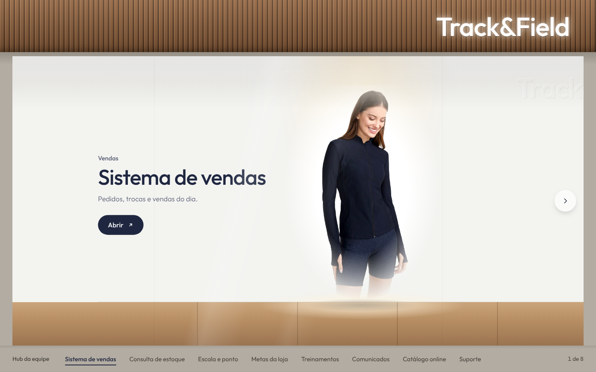

# Hub da equipe Track&Field

Página de links da equipe com o tema da vitrine da loja. A câmera passa pela vitrine e cada manequim ou cubo leva a um site. Roda no Google Apps Script, sem login, e os links vêm de uma Planilha Google.

| | |
|---|---|
| Planilha de links | [Hub Track&Field: links](https://docs.google.com/spreadsheets/d/1eSkaq6dsmBnoYOXWYdMJFE7LAEQMngrRszZE_ed4OUE/edit) |
| Projeto no Apps Script | [abrir no editor](https://script.google.com/d/1g-Re2_3aVLnRRAj_56KY8RO1RIAdNUp-9NhAM2XxMt5NHkWEf-Kkn_2c/edit) |
| Histórico de mudanças | [CHANGELOG.md](CHANGELOG.md) |



## Estrutura

| Caminho | O que é |
|---|---|
| `src/Code.gs` | Servidor: lê a aba **Links** da planilha e entrega a página. |
| `src/Index.html` | A vitrine: visual, animações e navegação, num único arquivo. |
| `src/appsscript.json` | Manifesto do Apps Script: fuso horário e acesso do app da Web (qualquer pessoa, sem login). |
| `scripts/publicar.sh` | Envia `src/` para o Apps Script e atualiza a implantação. |
| `.github/workflows/publicar.yml` | Roda o `publicar.sh` a cada mudança em `src/` na branch `main`. |
| `.clasp.json` | Liga a pasta `src/` ao projeto do Apps Script. |
| `docs/` | Conceito visual (`conceito/storyboard.html`) e prévias da página. |

## Editar os links

Os links ficam na planilha, não no código. A página reflete a mudança na próxima visita.

| Coluna | Uso |
|---|---|
| Ordem | Posição na vitrine, da esquerda para a direita. |
| Ativo | Desmarque para esconder o link sem apagar a linha. |
| Nome | Texto do letreiro e da barra de links. |
| Categoria | Linha pequena acima do nome. |
| Descrição | Uma frase sobre o destino. |
| URL | Endereço completo, começando com `https://`. Outros formatos são ignorados. |
| Produto | Nome do produto exposto (referência para os renders 3D). |
| Expositor | `Manequim` para roupas, `Cubo` para malas e acessórios. |
| Imagem | Foto do produto. Fotos do site tf.com.br são redimensionadas automaticamente. |

## Desenvolvimento

1. `npm install`
2. Para ver a página sem publicar, abra `src/Index.html` no navegador. Fora do Apps Script ela usa os 8 links de exemplo que estão no próprio arquivo.
3. Faça a mudança, atualize a documentação (veja abaixo) e faça o commit na `main`.

Navegação da página: setas na tela, teclado (← →, Home, End, 1 a 9, Enter abre o link atual), roda do mouse, arrastar com o mouse ou deslizar o dedo, e a barra com todos os links.

## Publicação

O código publicado é sempre o que está na `main`.

**Automática.** Cada push na `main` que muda `src/` roda o workflow **Publicar no Apps Script**: ele envia os arquivos com o clasp e atualiza a implantação do app da Web. A URL da equipe não muda. Também dá para rodar o workflow à mão na aba **Actions**.

**Manual**, de um computador com as credenciais do clasp:

```sh
DEPLOYMENT_ID=<id da implantação> npm run publicar
```

### Configuração inicial (uma vez)

1. Ative a **API do Google Apps Script** em <https://script.google.com/home/usersettings>.
2. No terminal, rode `npx clasp login` e autorize com a conta dona do script. Isso cria o arquivo `~/.clasprc.json`.
3. Rode `npx clasp deployments` e copie o ID da implantação do app da Web (o que não é `@HEAD`).
4. No GitHub, em **Settings → Secrets and variables → Actions**:
   - Aba **Secrets**: crie `CLASPRC_JSON` com o conteúdo inteiro do `~/.clasprc.json`.
   - Aba **Variables**: crie `DEPLOYMENT_ID` com o ID do passo 3.

O `~/.clasprc.json` dá acesso aos seus scripts do Google. Ele nunca entra no repositório (está no `.gitignore`) e não deve ser colado em conversas ou issues.

## Roteiro

| Fase | Conteúdo | Situação |
|---|---|---|
| 1 | Planilha, Apps Script e vitrine com fotos do site | Concluída |
| 2 | Cenário da loja no Blender e render de teste de uma parada | Próxima |
| 3 | Produtos em 3D, renders finais e transições em vídeo | A fazer |
| 4 | Acabamento, testes em celular e computador | A fazer |

## Cuidados

- Qualquer pessoa com a URL vê a lista de links. Não coloque senhas nem links com token na planilha.
- Por ser uma conta pessoal, o Google mostra uma faixa no topo da página dizendo que o app foi criado por um usuário. Não dá para remover.
- As fotos vêm do site tf.com.br e serão trocadas pelos renders 3D na fase 3.

## Documentação

Toda mudança no projeto atualiza, no mesmo commit, o que ela afeta neste README e uma entrada no [CHANGELOG.md](CHANGELOG.md).
